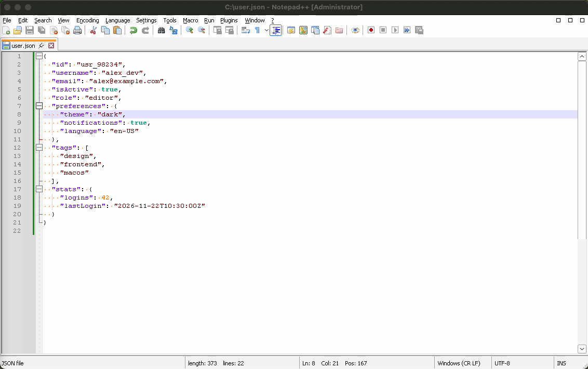

# VimPad++

VimPad++ brings Vim-style editing to Notepad++ on Windows, powered by an
embedded Neovim process. Use Vim motions, commands, and mappings while keeping
Notepad++ as your editor.



## Getting started

The steps below build and install the Neovim backend from source. For all build,
run, and test targets, see the [command guide](plugin/makefile-commands.md).

### Requirements

To run the plugin, you need Windows x64, the x64 version of
[Notepad++](https://notepad-plus-plus.org/downloads/), and the Windows Neovim
files installed alongside the plugin as described below. A minimum supported
Notepad++ version has not yet been documented.

The documented development setup cross-compiles Windows binaries with MinGW
and runs them through Wine. Building requires:

- Make and a shell compatible with the Makefile recipes.
- The MinGW x64 C++ compiler, available as `x86_64-w64-mingw32-g++`.
- Python 3, available as `python3`, for staging the Neovim distribution.
- The dependency files below, which are not committed to this repository.

| Path under `plugin/` | Required content | Where to obtain it |
| --- | --- | --- |
| `dependencies/neovim/` | A Windows x64 Neovim distribution, including `bin/nvim.exe` and its runtime files. | [Neovim downloads](https://neovim.io/doc/install/#install-from-download) |
| `dependencies/scintilla/` | A Windows x64 Scintilla distribution with `Scintilla.dll` and `License.txt`, used by the standalone host built by this target. | [Scintilla downloads](https://www.scintilla.org/ScintillaDownload.html); the DLL is included in the full SciTE download. |

Extract the Neovim archive so that `bin/` is directly inside
`plugin/dependencies/neovim/`. The backend starts this Windows `nvim.exe`;
an installed macOS or Linux `nvim` cannot replace it. Development used Windows
Neovim **v0.12.6**. Other releases have not been verified here.

Dependency directories are Git-ignored. To use another location, pass
`NEOVIM_DIR` or `SCINTILLA_DIR` to Make. Relative paths are resolved from
`plugin/`.

Wine is needed to run the Windows host and tests in the documented development
setup. Fuzzing also needs a local `nvim` executable as its reference. See the
[functional test guide](plugin/tests/README.md) and
[fuzzing guide](plugin/tests_fuzzing/README.md) for details.

### Build and install

Close Notepad++ before replacing an installed plugin DLL. From the repository
root, run:

```sh
make -C plugin installnvim \
  NOTEPADPP_PLUGIN_DIR='/path/to/Notepad++/plugins/VimPad++'
```

Replace the path with your Notepad++ plugin directory. The Makefile's default
path points to the original developer's Wine installation.

This target builds `VimPad++.dll`, stages Neovim and the bootstrap script, then
copies the DLL and `neovim/` directory into your plugin directory. The DLL must
be inside a matching `plugins/VimPad++/` directory. Start Notepad++ after the
installation finishes.

To build without installing, run `make -C plugin nvim`. Its outputs are under
`plugin/build/windows-x64/neovim-build/`.

When upgrading from an older installation named `VIM-Motions-for-NotepadPP`,
keep Notepad++ closed, back up the old plugin directory, and move any settings
you want to keep into the new `VimPad++` directory. This includes `config/` and
any custom `neovim/init.lua`. Remove the old plugin directory before starting
Notepad++, so it cannot load both copies.

Staging and installation preserve existing `neovim/init.lua`,
`neovim/init.vim`, and `neovim/vim-motions-init.lua`. They also leave `config/`
alone. Other Neovim distribution files are updated. To update the bootstrap,
manually copy `plugin/src/neovim_init.lua` to the installed
`neovim/vim-motions-init.lua`. The bootstrap loads `neovim/init.vim` when
`neovim/init.lua` is absent; Lua takes precedence when both files exist.

### First use

1. Open a document in Notepad++. VimPad++ tries to enable itself at startup.
   Check **Plugins > VimPad++ > Enable VimPad++**; a check mark means it is
   enabled. Select the item to turn it on or off.
2. Editing starts in Normal mode. Press `i` to enter Insert mode and type text.
   Press Escape to return to Normal mode. Use `h`, `j`, `k`, and `l` to move.
3. In Normal mode, enter `:w` and press Enter to ask Notepad++ to save the
   active document. You can also use Notepad++'s Save command. Ctrl+S passes to
   Notepad++ when configured in `config/vimpad.lua`, as shown below.
4. Use Notepad++ to close documents or exit. Neovim quit commands such as `:q`
   can stop the background process; they do not close the Notepad++ document.

## Configuration

The following settings apply to the Neovim backend. All paths in this section
are relative to the installed plugin directory containing `VimPad++.dll`.
Configuration commands are under **Plugins > VimPad++**.

### VimPad++ settings

Plugin settings live in `config/vimpad.lua`. Use **Open VimPad++ config** to
create or open it. This file returns a Lua table and is separate from Neovim's
options and mappings:

```lua
return {
  passthrough_keys = {
    "<C-s>", 
    "<C-Tab>",
    "<C-S-Tab>",
    "<C-w>",
    "<C-n>"
  }
}
```

These shortcuts pass straight to Notepad++ in every Vim mode without being sent
to Neovim. Notepad++ must have the corresponding shortcuts assigned. With
`<C-s>` in this list, Ctrl+S saves the text currently visible in Notepad++.
It does not wait for pending Neovim input. Edits applied afterward leave the
document modified again. Keys outside the list continue through Vim handling.

Keys use angle brackets with optional `C-`, `S-`, and `A-` modifiers for Ctrl,
Shift, and Alt. Names are case insensitive and modifiers must match exactly:
`<C-s>` does not include Ctrl+Shift+S. Supported keys are letters A–Z, digits
0–9, F1–F24, Tab, Space, CR/Enter, BS/Backspace, Esc, Left, Right, Up, Down,
Home, End, PageUp, PageDown, Insert, and Del/Delete. These are individual
physical shortcuts, not Vim mappings or multi-key sequences.

A missing file or omitted `passthrough_keys` means the list is empty. Invalid
settings or key names report an error and prevent Vim from being enabled.
The native backend does not load these settings.

### Neovim settings

Use **Open Neovim config** to open `neovim/init.lua`, creating it if missing.
For example, put the following in that file. These are optional preferences;
the plugin does not require these mappings or indentation settings:

```lua
vim.opt.hlsearch = false
vim.opt.incsearch = false

vim.keymap.set('i', 'jj', '<esc>')
vim.keymap.set('i', 'kk', '<esc>')
vim.keymap.set('v', 'ii', '<esc>')

vim.opt.clipboard = "unnamedplus"

-- Map Ctrl+V to paste in Insert and Command modes
vim.keymap.set("i", "<C-v>", "<C-r>+", { noremap = true, silent = true })
vim.keymap.set("c", "<C-v>", "<C-r>+", { noremap = true })

-- Map Ctrl+Q to Ctrl+W in insert mode because Ctrl+W is used for closing a window 
vim.keymap.set("i", "<C-q>", "<C-w>")

-- some nice to have's
vim.keymap.set("n", "H", "0")
vim.keymap.set("n", "L", "$")

vim.opt.expandtab = true   -- Convert tabs to spaces
vim.opt.tabstop = 2        -- Number of spaces a <Tab> counts for
vim.opt.softtabstop = 2    -- Number of spaces inserted/deleted when pressing <Tab> or <BS>
vim.opt.shiftwidth = 2     -- Number of spaces used for auto-indent and << / >>
```

The Ctrl+V mappings above apply only in Insert and Command-line modes.
Normal-mode Ctrl+V still enters Visual Block mode. The `H` and `L` mappings
replace their usual Vim motions with the start and end of the current line.
The Ctrl+Q mapping provides Insert-mode Ctrl+W behavior when Ctrl+W is passed
to Notepad++ to close a document.

The plugin handles Neovim `:w` through a save notification to Notepad++ after
pending state has been applied. Host Ctrl+S passthrough is a separate path:
it saves the visible text immediately, as described above.

The bootstrap, `neovim/vim-motions-init.lua`, loads settings in this order:

1. `neovim/init.lua`, or `neovim/init.vim` when the Lua file is absent.
2. Either `config/init.lua` or `config/init.vim`, if present. Keep only one;
   having both is an error. Settings here can override the bundled init file.

It also adds `config/` and `config/after/` to Neovim's runtime search path.
**Open config folder** opens `config/`. Your usual Neovim init file
is not loaded automatically. Configuration and plugins may behave differently
from a normal Neovim UI; test them in this integration.

### Apply configuration changes

Save your changes, then select **Reload VimPad++ and Neovim configs**. Settings
are also read when a document's Neovim session starts.

Reload releases the existing document sessions and recreates sessions for the
visible documents. Pending Vim commands and any state held only in Neovim are
discarded; the text visible in Notepad++ is retained. Reloading while VimPad++
is disabled leaves it disabled; use **Enable VimPad++** to turn it on.

## Known limitations

- Folding does not yet behave properly in the Notepad++ integration.
- The viewport commands `zt`, `zz`, and `zb` do not scroll the Notepad++ view
  as they do in Neovim.
- `:q` and related quit commands can exit the background Neovim process.
  Use Notepad++ to close documents instead.
- Documents containing NUL bytes are not supported by the Neovim backend.
- The standalone functional harness tests a Scintilla control, not the full
  Notepad++ plugin lifecycle. Actual Notepad++ keyboard routing, multiple
  views and documents, and interaction with other plugins need more validation.
- Performance has not been systematically measured.
- External editor changes still trigger full-text comparisons. Some startup
  and synchronization calls can block the UI while waiting for Neovim.

This list is not exhaustive. Some Vim commands may fail or behave differently;
not every command has been tested. See the
[integration review findings](docs/neovim-review-findings.md) for review details
and verification limits.

## Troubleshooting and bug reports

| Problem | What to check |
| --- | --- |
| Build reports missing dependencies | Check the paths in Requirements. Neovim needs its complete Windows runtime, not just `nvim.exe`. |
| Plugin does not appear in Notepad++ | Check that x64 `VimPad++.dll` is inside `plugins/VimPad++/` and restart Notepad++. |
| Vim cannot be enabled | Read the error dialog. Check `neovim/bin/nvim.exe`, `neovim/vim-motions-init.lua`, and any configuration errors. |
| A configured shortcut does not work | Check that Notepad++ assigns it, the modifiers match, and the config was saved and reloaded. |
| Neovim exits or reports a communication error | The current implementation disables VimPad++ after a reported session failure. Fix any reported cause, then select **Enable VimPad++** to start fresh sessions. |
| An installed update still uses old startup behavior | Existing bootstrap files are preserved. Update the installed `neovim/vim-motions-init.lua` manually if needed. |

Disabling and re-enabling VimPad++ starts fresh sessions from the visible editor
text. State held only in Neovim cannot be recovered this way.

Report problems through [GitHub Issues](https://github.com/filipplays/VimPadPP/issues).
Include your Windows, Notepad++, and Neovim versions; the backend and commit or
build used; the relevant configuration; and the smallest sequence of steps that
reproduces the problem. Describe what you expected and what happened, and copy
any error message.

## Development and documentation

Development currently focuses on the Neovim backend. A separate native Vim
engine is also included. Each build uses one backend; there is no in-app
backend selector.

Start with the [documentation index](docs/README.md) for architecture and design
notes. The [command guide](plugin/makefile-commands.md) covers building, running,
testing, fuzzing, and replay. The native backend can be built with
`make -C plugin native` and installed with `make -C plugin installnative`.

For fixes and contributions, describe the problem, the change, and the checks
performed. The [functional test guide](plugin/tests/README.md) and
[fuzzing guide](plugin/tests_fuzzing/README.md) explain what the tests cover
and their limits.

### Repository layout

- `plugin/src/notepadpp_plugin.cpp` contains the Notepad++ entry points and
  attaches the plugin to its Scintilla views.
- `plugin/src/backends/neovim/` contains the Neovim process, RPC, and editor
  synchronization code. `plugin/src/backends/native/` contains the native
  engine; `plugin/src/backends/common/` has shared editor and backend code.
- `plugin/src/main.cpp` is a standalone Scintilla host used for development.
- `plugin/src/neovim_init.lua` is the committed Neovim bootstrap script.
- `plugin/tests/` contains functional and focused protocol tests;
  `plugin/tests_fuzzing/` contains differential fuzzing tools.
- `docs/` holds project documentation.

## License

VimPad++ is licensed under the [MIT License](LICENSE). Neovim and Scintilla
are covered by their own licenses.
