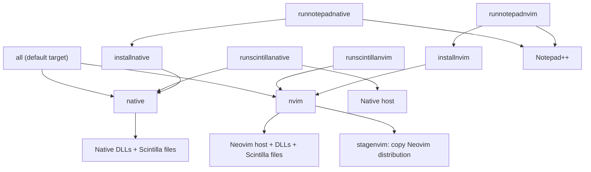
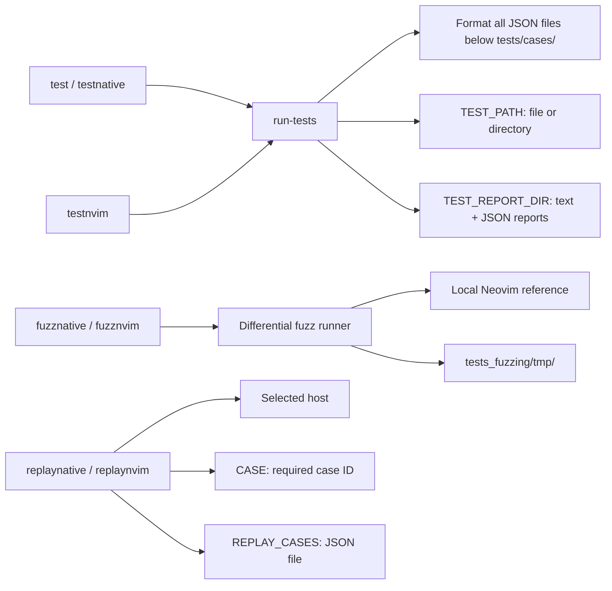

# Makefile map

A visual companion to [makefile-commands.md](makefile-commands.md). From the
repository root, run `make -C plugin <target>`. Arrows show what each target
uses or launches; paths below are relative to `plugin/`.

## Build and launch

The native build defaults to `build/windows-x64/both/`; the Neovim build uses
`build/windows-x64/neovim-build/`. `BACKENDS` changes the native directory
suffix, not which backend a target builds.

## Test, fuzz, and replay

`WAIT_MS` controls the fixed delay before each functional result is checked;
`VISIBLE=1` shows the test window. The test runner writes to
`tests/functional/tmp/reports/` by default. Fuzzing has its own temporary
directory and replaces the previous fuzz run. Focused checks under
`tests/neovim/` run through `ci-portable`, `ci-nvim-build`, and
`ci-nvim-integration`. See the
[test guide](tests/README.md#focused-neovim-checks) for their commands and coverage.

Replay requires `CASE=<id>`; `REPLAY_CASES=<json-file>` defaults to
`tests_fuzzing/tmp/cases/generated.json`. `replay` selects the native backend.
For the shared `run-replay` target, `REPLAY_APP` optionally selects an
already-built host. See the [replay examples](makefile-commands.md#replay-a-test-case).

Backend-specific test, fuzz, and replay targets prepare their runtime files
before invoking the shared recipes; Neovim targets also stage Neovim.
The shared `run-tests`, `run-fuzz`,
`run-fuzz-seed`, and `run-replay` targets do not independently prepare every
backend dependency.
